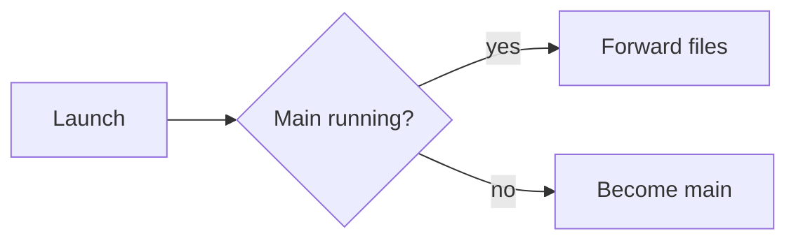
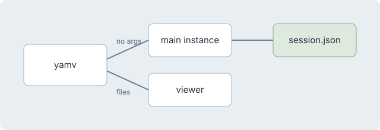

# YAMV sample document

This file exercises every construct the renderer emits. Read [the architecture notes](../../ARCHITECTURE.md), jump to [the code section](#code), or visit <https://example.com>. Press <kbd>Ctrl</kbd> <kbd>F</kbd> to find text.

> Only one main instance runs at a time; any launch with files opens its own viewer window.

## Tables

| Platform | Runtime | Artifact |
|---|---|---|
| Windows 11 | `win-x64` | yamv.exe |
| macOS 14+ | `osx-arm64` | YAMV.app |

## Task list

- [x] Run the full test suite in Release
- [ ] Check live reload with an editor that saves by rename

## Code

```c#
var doc = renderer.Render("# Hello"); // title: Hello
for (int i = 0; i < 3; i++) { Console.WriteLine($"line {i}"); }
```

```python
def greet(name: str) -> str:
    return f"Hello, {name}"  # the greeting
```

## Diagram



## Math

Inline math $e^{i\pi} + 1 = 0$ sits in the text, and a block follows:

$$
\int_0^1 x^2 \, dx = \frac{1}{3}
$$

## Image



## Other text

~~Struck out~~ text, a footnote reference[^1], and a rule:

---

1. First
2. Second
   - nested

## Hostile markup

<script>alert(1)</script>


[^1]: The footnote text.
